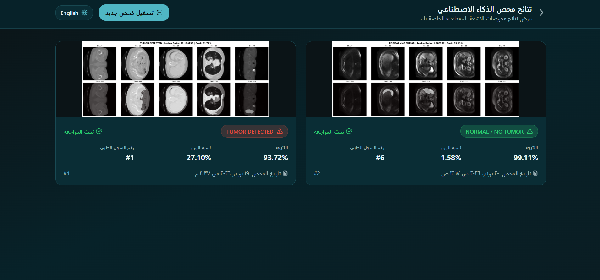
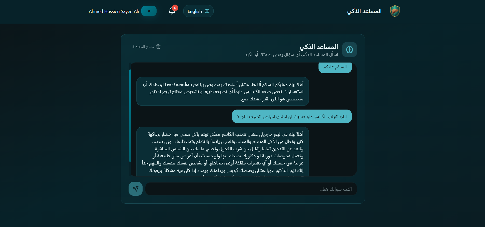

# LiverGuardian

**An AI system for liver cancer screening and lesion diagnosis that follows the path a real patient takes: blood work, then CT, then multi-phase MRI.**

> ⚠️ **Research prototype.** LiverGuardian was built as a graduation project. It is not a medical device and must not be used for real clinical decisions.

---

## Why this project

Liver cancer causes more than 830,000 deaths every year (WHO). Outcomes depend heavily on how early it is found, and the diagnosis is hard because liver lesions range from harmless cysts to aggressive tumors.

In practice, a patient is not diagnosed from a single scan. Blood tests come first, CT is usually the first imaging step, and MRI is used when the lesion needs a closer look. Most AI projects handle only one of these steps. LiverGuardian connects all three in one pipeline.

## How it works

```
 Blood tests ──► Clinical module (CatBoost)   ──► risk level: Low / Moderate / High Suspicion
                         │
                         ▼
 CT scan ──────► CT module (3D Residual U-Net) ──► tumor mask + cancer detected / not detected
                         │
                         ▼
 8 MRI phases ─► MRI module                    ──► tumor mask + Malignant or Benign + disease type
                  ├─ cascaded 3D segmentation (DWI → T2WI → DWI)
                  └─ hierarchical 3D ResNet classification
```

## Modules

### 1. Clinical risk (`clinical/`)

A CatBoost classifier trained on 5,000 patient records. It takes 13 inputs (age, gender, BMI, alcohol consumption, smoking status, hepatitis B and C, liver function score, alpha-fetoprotein level, cirrhosis history, family history of cancer, physical activity level, diabetes) and returns a risk percentage.

| Metric | Result |
|---|---|
| Accuracy | 98% |
| ROC-AUC | 99% |

Risk levels: below 30% is Low, 30–60% is Moderate, 60% and above is High Suspicion.

### 2. CT tumor segmentation (`ct/`)

A 3D Residual U-Net trained on the LiTS benchmark (131 contrast-enhanced CT volumes). Scans are windowed to the liver soft-tissue range (−100 to +400 HU) and resized to 96×96×48. The service reports "cancer detected" when the predicted tumor covers at least 0.3% of the volume.

| Metric | Result |
|---|---|
| Dice coefficient | 0.9094 |
| Binary pixel accuracy | 99.45% |

### 3. MRI lesion diagnosis (`mri/`)

Built on LLD-MMRI-MedSAM2: 498 patients, 8 MRI phases per patient (3,984 scans), 7 lesion types.

- Malignant: Hepatocellular Carcinoma, Intrahepatic Cholangiocarcinoma, Hepatic Metastasis
- Benign: Hemangioma, Abscess, Cyst, Focal Nodular Hyperplasia

**Cascaded segmentation.** Feeding all 8 phases into one model gave a Dice of only 0.313. Instead, three 3D Residual U-Nets work in sequence, the way a radiologist reads the study: DWI first, then T2WI refined with the first mask, then DWI again refined with the second mask.

| Stage | Input | Val Dice |
|---|---|---|
| Baseline | all 8 phases, one model | 0.313 |
| Model 1 | DWI | 0.453 |
| Model 2 | T2WI + mask 1 | 0.429 |
| **Model 3 (final)** | DWI + mask 2 | **0.456** |

**Hierarchical classification.** Trying to classify 7 classes directly with one model (Focal Loss) reached only 29.7% validation accuracy. Splitting the problem into three 3D ResNets worked better at each step:

| Step | Task | Val accuracy | Test accuracy |
|---|---|---|---|
| 1 | Malignant vs Benign | 62.5% | 65.3% |
| 2 | Malignant type (3 classes) | 70.6% | 40.8% |
| 3 | Benign type (4 classes) | 59.4% | 50.0% |

All MRI models were trained on a single Windows laptop with an RTX 4050 (6 GB), without Linux or a large GPU.

### 4. Chatbot (`chatbot/`)

A FastAPI service backed by Gemini that answers general questions about the system and liver health in Egyptian Arabic, and always advises seeing a doctor.

## Screenshots

| CT | MRI: benign lesion |
|---|---|
|  |  |

| MRI: malignant lesion | Chatbot |
|---|---|
|  |  |

More detail is in the [project documentation](docs/LiverGuardian%20Documentation.pdf).

## Limitations

- **Small dataset.** 498 MRI patients split across 7 classes (32 to 114 patients per class) limits the type classifiers. The gap between validation and test accuracy in steps 2 and 3 comes from this and from very small test groups.
- **Errors carry forward.** If the first MRI step routes a patient to the wrong branch, the type classifier cannot recover. Run end to end on the test set, the full 7-class pipeline reached 28% accuracy, which is why the per-step results above matter and why this system is best seen as a proof of concept, not a finished diagnostic tool.
- **Segmentation.** The MRI Dice of 0.456 is well below the CT result, which reflects the difficulty of MRI lesions and the small training set.
- **CT decision rule.** The CT service decides on a fixed tumor-ratio threshold, not a learned classifier.

## Repository structure

```
LiverGuardian/
├── clinical/    CatBoost risk model: notebook, Flask API, Dockerfile
├── ct/          3D Residual U-Net for CT: notebook, Flask API, Dockerfile
├── mri/         cascaded segmentation + hierarchical classification: notebooks, Flask API, Dockerfile
├── chatbot/     FastAPI + Gemini assistant: main.py, Dockerfile
├── models/      links to the trained model files
└── docs/        screenshots and project documentation
```

## Trained models

The model files are not stored in this repository because of their size. See [`models/README.md`](models/README.md) for the download link and where each file goes.

## APIs

Each service is a small web API that listens on port 7860 and includes a Dockerfile.

| Service | Endpoint | Input |
|---|---|---|
| Clinical | `POST /predict` | JSON with the 13 clinical fields |
| CT | `POST /predict_ct` | a `.nii` CT volume (form field `file`) |
| MRI | `POST /predict_mri`, then `GET /task_status/<task_id>` | a ZIP with the MRI phases as NIfTI files (form field `file`) |
| Chatbot | `POST /ask` | JSON `{"message": "..."}` |

**Chatbot API key.** The Gemini key is not in the code. Set it as an environment variable before starting the chatbot:

```bash
# Windows PowerShell
$env:GEMINI_API_KEY="your_key"

# Linux / macOS
export GEMINI_API_KEY="your_key"

# Docker
docker run -e GEMINI_API_KEY=your_key ...
```

## Tech stack

Python, PyTorch (MRI), TensorFlow/Keras (CT), CatBoost, Flask, FastAPI, Docker, nibabel, scikit-image, Google Gemini.

## Data sources

- **CT:** LiTS, the Liver Tumor Segmentation Benchmark
- **MRI:** [LLD-MMRI](https://github.com/LMMMEng/LLD-MMRI-Dataset), using the [LLD-MMRI-MedSAM2](https://huggingface.co/datasets/wanglab/LLD-MMRI-MedSAM2) release
- **Clinical:** 5,000 patient records with 14 columns (13 inputs and a cancer label)

## Team

Modern Academy for Computer Science and Management, Cairo, Egypt

Team Leader: Omar EL-Salhy,
Sub-Team Leader :Ahmed Hussien, 
Ali Ahmed, Mohamed Anwer, Mahmoud Tolpa

Supervision: Mohamed Hassan (Teaching Assistant), Dr. Mohamed AbdelFattah (Assistant Professor), Prof. E. M. Haggag (Faculty of Medicine, Cairo University)
